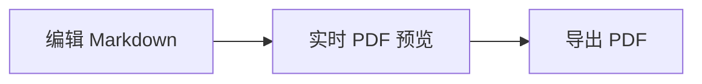

# Markdown Compiler 演示文档

这是一份可用于逐项体验源码编辑、预览编辑和 PDF 导出的示例。可以修改这段文字，观察右侧预览。

## 常用 Markdown

**加粗**、*斜体*、~~删除线~~、==高亮文字==、`行内代码`，以及 [GitHub](https://github.com/)。
换行前使用反斜杠：\
所以这一句另起一行。

- 无序列表
  - 嵌套项目
- [ ] 待完成的任务
- [x] 已完成的任务

| 功能 | 状态 | 数量 |
| :--- | :---: | ---: |
| 实时预览 | 可用 | 1 |
| PDF 导出 | 可用 | 2 |

下面是行内公式 $E=mc^2$，以及独立公式：

$$
\sum_{i=1}^{n} i = \frac{n(n+1)}{2}
$$

```js
const greeting = '你好，Markdown';
console.log(greeting);
```



<!-- pagebreak -->

## 标题、引用与链接

### 三级标题

#### 四级标题

##### 五级标题

###### 六级标题

1. 有序列表第一项
2. 有序列表第二项
   1. 嵌套编号

> 引用可以包含 **加粗文字**。
>
> 第二段引用可以继续使用 [GitHub 仓库](https://github.com/serendipitylin0731/markdown_preview-compiler)。

转义符号：\*这里的星号不会变成斜体\*。参考式链接：[项目主页][project]；自动链接：<https://github.com/>。

[project]: https://github.com/serendipitylin0731/markdown_preview-compiler

---

## 图片与脚注

本地图片使用仓库中的 Logo：


在线图片的示例：


技术文档还可以使用脚注[^note]。图片加载需要网络或本地文件可用。

## HTML 与折叠块

普通 HTML 可以包含 <kbd>Ctrl</kbd>、上标 x<sup>2</sup>、下标 H<sub>2</sub>O、<mark>HTML 高亮</mark> 和换行<br>后的内容。

<details>
<summary>HTML 折叠框：参考答案</summary>

展开后可以看到 **Markdown 加粗**、列表和代码：

- 第一条
- 第二条

```bash
printf 'hello\n'
```

</details>

:::info[]
这是无标题的 `:::info[]` 折叠提示，内容也支持 **Markdown**。
:::

:::warning[自定义标题]
这里是有标题的警告折叠块。
:::

[^note]: 脚注会显示在文档末尾。
