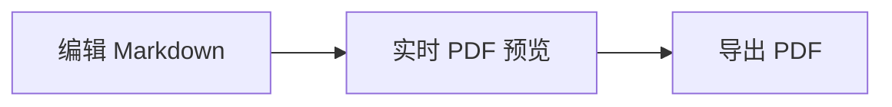

# Markdown Compiler 演示文档

这是一份可用于逐项体验源码编辑、所见即所得编辑和 PDF 导出的示例。可以修改这段文字，观察右侧预览。

## 常用 Markdown

- **加粗**、*斜体*、~~删除线~~与 [VS Code](https://code.visualstudio.com/)
- [ ] 待完成的任务
- [x] 已完成的任务

| 功能 | 状态 |
| :--- | ---: |
| 实时预览 | 可用 |
| PDF 导出 | 可用 |

下面是行内公式 $E=mc^2$，以及独立公式：

$$
\sum_{i=1}^{n} i = \frac{n(n+1)}{2}
$$

```js
const greeting = '你好，Markdown';
console.log(greeting);
```



<!-- pagebreak -->

## 第二页

这个标题前面有手动分页符。可在所见即所得模式下选择分页标记删除，也可以在工具栏为其他段落添加分页符。

技术文档还可以使用脚注[^note]。

[^note]: 脚注会显示在文档末尾。
