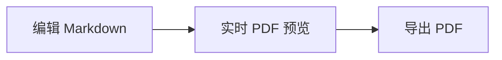

# Markdown Compiler 演示文档

这份文档按语法分组，可以用来体验源码编辑、分屏预览、预览编辑和 PDF 导出。

## 标题、文字与引用

### 三级标题

#### 四级标题

##### 五级标题

###### 六级标题

**加粗**、*斜体*、~~删除线~~、==高亮文字==和 `行内代码`。

转义符号：\*这里的星号不会变成斜体\*。换行前使用反斜杠：\
所以这一句另起一行。

> 引用可以包含 **加粗文字**。
>
> 第二段引用可以继续使用 [GitHub 仓库](https://github.com/serendipitylin0731/markdown_preview-compiler)。

---

## 列表与任务

- 无序列表
  - 同类型嵌套项目
  - 无序列表中的有序列表
    1. 第一个有序项目
    2. 第二个有序项目
- [ ] 待完成的任务
- [x] 已完成的任务

1. 有序列表第一项
2. 有序列表第二项
   - 有序列表中的无序项目
   - 另一个无序项目
     1. 更深一层的有序项目

## 表格

| 功能 | 状态 | 数量 |
| :--- | :---: | ---: |
| 实时预览 | 可用 | 1 |
| PDF 导出 | 可用 | 2 |

## 数学公式

单美元符号行内公式 $E=mc^2$；双美元符号行内公式 $$a^2+b^2=c^2$$；反斜杠括号行内公式 \(x+y=z\)；行内方括号公式 \[u+v=w\]。

双美元符号独立公式：

$$
\sum_{i=1}^{n} i = \frac{n(n+1)}{2}
$$

在公式中定义的宏可在本文档的后续公式中使用：

$$
\newcommand{\RR}{\mathbb{R}}
\newcommand{\vect}[1]{\boldsymbol{#1}}
$$

例如 $\vect{v}\in\RR^2$，也可以在独立公式中使用：

\[
\vect{x}+\vect{y}\in\RR^2
\]

反斜杠方括号独立公式，以及粗体符号与分段大括号：

\[
\boldsymbol{E}=\begin{cases}
0,&r<a,\\
\dfrac{Q}{4\pi\epsilon_0 r^2}\bm{e}_r,&a<r<2a,\\
0,&r>2a.
\end{cases}
\]

分段公式中也可以使用运算符名称和中文文本：

$$
\operatorname{branch}(u,v,w)=
\begin{cases}
(v,w),&v=n\text{ 或 }in[v]=2,\\
(stop[v],w+r[v]),&\text{否则}.
\end{cases}
$$

列表中的多行公式可以紧跟文字，不需要额外空行：

2. 计算
   $$
   \mathbb{E}\left[2^{2X_m}\right]\,,
   $$
   并证明
   $$
   \operatorname{Var}\left[\widehat m\right]=\frac{m^2-m}{2}\le\frac{m^2}{2}.
   $$

## 代码与行号

代码框会显示语言和语法高亮。行号可从 1 开始，也可指定起始行号：

```js
const greeting = '你好，Markdown';
console.log(greeting);
```

```python=
def greet(name):
    message = f"Hello, {name}!"
    return message

print(greet("Markdown"))
```

```python=10
answer = 42
print(answer)
```

## 链接、图片与脚注

普通链接：[GitHub](https://github.com/)；参考式链接：[项目主页][project]；自动链接：<https://github.com/>。

[project]: https://github.com/serendipitylin0731/markdown_preview-compiler

本地图片使用仓库中的 Logo：


在线图片的示例：


技术文档还可以使用脚注[^note]。图片加载需要网络或本地文件可用。

## HTML 与折叠块

普通 HTML 可以包含 <kbd>Ctrl</kbd>、上标 x<sup>2</sup>、下标 H<sub>2</sub>O、<mark>HTML 高亮</mark> 和换行<br>后的内容。

<details>
<summary>HTML 折叠框：参考答案</summary>

展开后可以看到 **Markdown 加粗**、列表和代码：

- 第一条
- 第二条

```bash
printf 'hello\n'
```

</details>

:::info[]
这是无标题的 `:::info[]` 折叠提示，内容也支持 **Markdown**。
:::

:::info Hint for 1
也可以在 `info` 后直接写标题。
:::

:::warning[自定义标题]
这里是有标题的警告折叠块。
:::

:::warning Watch out
`warning` 同样支持空格后的自定义标题。
:::

::: 直接写标题的普通折叠框
普通折叠框和 HTML `details` 一样，可以包含 **Markdown** 内容。
:::

:::
没有自定义标题的普通折叠框。
:::

## 图表与分页



下面的注释是手动分页符：

<!-- pagebreak -->

分页后的内容可以继续编辑，脚注也会显示在文档末尾。

[^note]: 脚注会显示在文档末尾。
